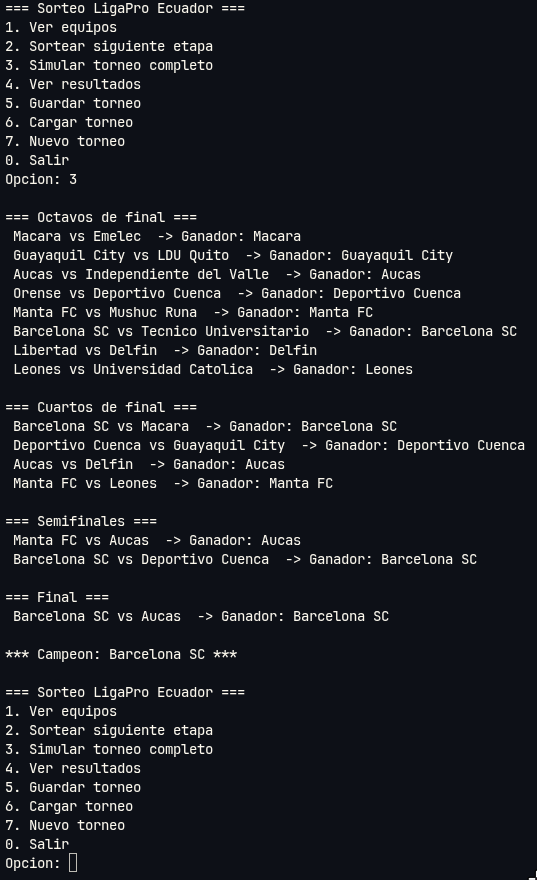
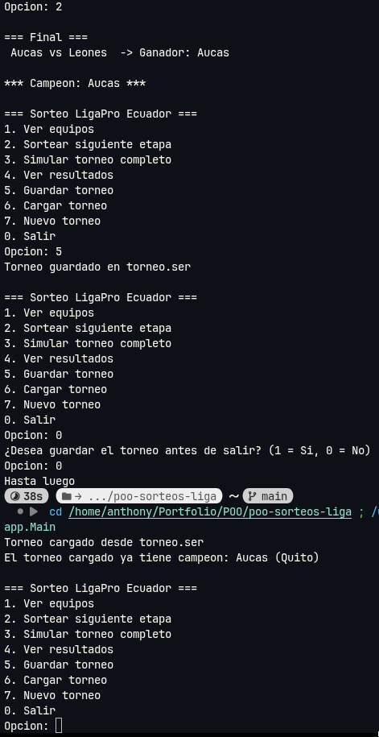
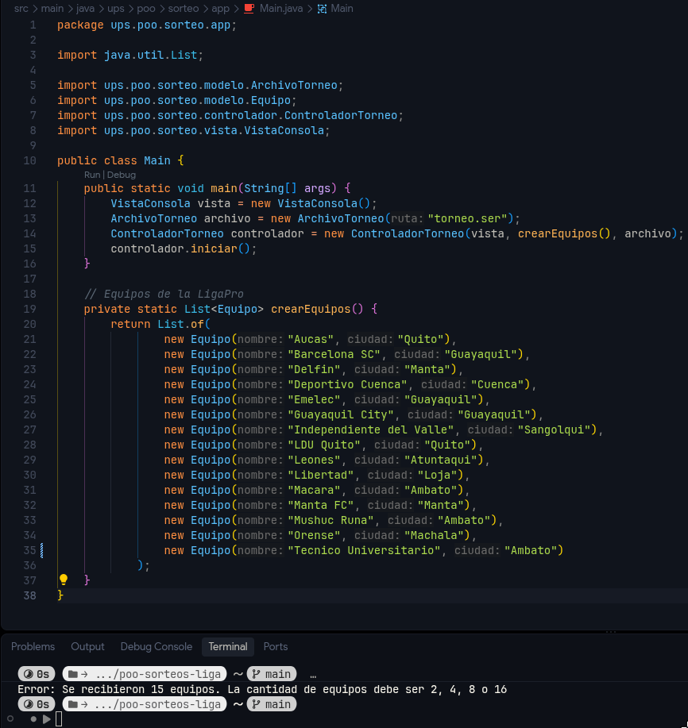
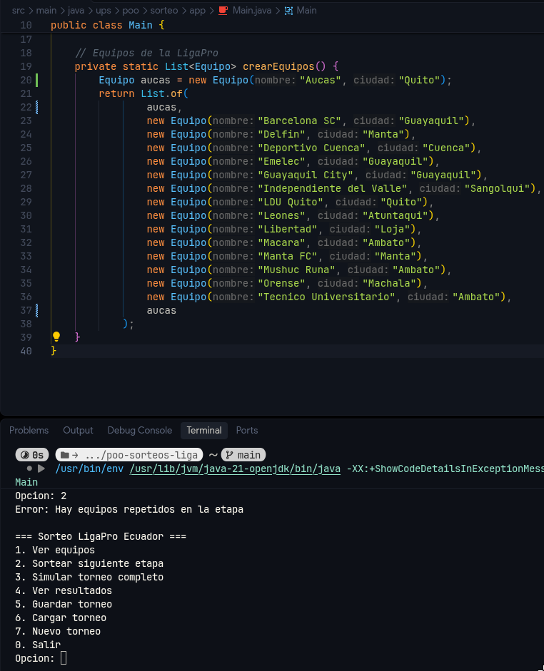

# Sorteo de Liga Profesional — POO Unidad 3

Aplicación de consola en Java que sortea un torneo de eliminación directa con los 16 equipos de la LigaPro Ecuador Serie A 2026, desde octavos de final hasta el campeón.

## Objetivos

- Organizar aleatoriamente los partidos de cada etapa mediante un algoritmo recursivo.
- Garantizar que ningún equipo repita partido en la misma etapa ni sea competidor y oponente a la vez.
- Manejar errores con excepciones personalizadas y capturar todas las excepciones con `try-catch`.
- Guardar y cargar el estado del torneo mediante serialización de objetos.
- Separar la aplicación en Modelo, Vista y Controlador.

## Estructura del proyecto

```
poo-sorteos-liga/
├── pom.xml
├── docs/img/                     Capturas de las pruebas
└── src/main/java/ups/poo/sorteo/
    ├── app/
    │   └── Main.java             Punto de entrada y los 16 equipos
    ├── controlador/
    │   └── ControladorTorneo.java
    ├── modelo/
    │   ├── Equipo.java
    │   ├── Partido.java
    │   ├── Etapa.java            octavos, cuartos, semifinales y final
    │   ├── Torneo.java           Estado del torneo y sorteo recursivo
    │   ├── ArchivoTorneo.java    Serialización y deserialización
    │   └── excepciones/
    │       ├── NumeroEquiposInvalidoException.java
    │       └── SorteoInvalidoException.java
    └── vista/
        └── VistaConsola.java
```

| Capa | Responsabilidad |
|---|---|
| **Modelo** | Datos del torneo, sorteo recursivo, simulación de ganadores, reglas y persistencia. No imprime ni lee del teclado. |
| **Vista** | Muestra el menú, los partidos, los resultados y los mensajes, y lee las opciones del usuario. No contiene lógica del torneo. |
| **Controlador** | Recibe la opción elegida, invoca al modelo, captura sus excepciones y le indica a la vista qué mostrar. |

## Requisitos

- JDK 17 o superior.
- Un IDE con soporte para Maven (Eclipse, IntelliJ IDEA, NetBeans o VS Code con el Extension Pack for Java).

## Cómo clonar y ejecutar

```bash
git clone https://github.com/nzanthony/poo-sorteos-liga.git
```

**Eclipse:** `File > Import > Maven > Existing Maven Projects`, seleccionar la carpeta clonada y ejecutar `Main.java` con `Run As > Java Application`.

**VS Code:** abrir la carpeta clonada como raíz del workspace y pulsar `Run` sobre el método `main` de `Main.java`.

**Terminal:**

```bash
cd poo-sorteos-liga
javac -d out $(find src/main/java -name "*.java")
java -cp out ups.poo.sorteo.app.Main
```

## Uso

Al iniciar, el programa busca el archivo `torneo.ser`. Si existe, carga el torneo guardado y muestra en qué etapa quedó; si no existe o está dañado, crea un torneo nuevo.

| Opción | Acción |
|---|---|
| 1 | Ver los 16 equipos participantes |
| 2 | Sortear la siguiente etapa: juega la etapa actual y sortea la siguiente con los ganadores |
| 3 | Simular el torneo completo hasta el campeón |
| 4 | Ver los resultados de todas las etapas jugadas |
| 5 | Guardar el torneo en `torneo.ser` |
| 6 | Cargar el torneo desde `torneo.ser` |
| 7 | Iniciar un torneo nuevo |
| 0 | Salir, con la opción de guardar antes |

Los ganadores de cada partido se definen de forma aleatoria.

## Sorteo recursivo

El emparejamiento de cada etapa lo realiza el método `emparejar` de `Torneo`:

- **Caso base:** no quedan equipos disponibles, por lo que se devuelven los partidos formados.
- **Caso recursivo:** se toma el primer equipo, se le asigna un rival al azar entre los restantes, se forma el partido, se retiran ambos equipos y el método se llama a sí mismo con dos equipos menos.

Como cada llamada retira a los dos equipos emparejados, ninguno puede repetir partido en la misma etapa, y como el índice del rival nunca es el del equipo local, ningún equipo juega contra sí mismo. Antes de iniciar la recursión, la lista se mezcla con `Collections.shuffle`.

La simulación del torneo completo (`simularTorneo`) también es recursiva: avanza una etapa y se llama de nuevo hasta que existe un campeón.

## Excepciones

| Excepción | Se lanza cuando | Se captura en |
|---|---|---|
| `NumeroEquiposInvalidoException` | La cantidad de equipos no es potencia de 2 entre 2 y 16 | `ControladorTorneo` |
| `SorteoInvalidoException` | El sorteo recursivo encuentra equipos repetidos, un equipo sin rival o un partido sin ganador | `ControladorTorneo` |
| `IOException` / `FileNotFoundException` | El archivo no existe, no se puede escribir o está dañado | `ControladorTorneo` |
| `ClassNotFoundException` | El archivo no corresponde a un torneo válido | `ControladorTorneo` |
| `NumberFormatException` | El usuario escribe un valor no numérico en el menú | `VistaConsola` |

Las dos excepciones propias extienden `Exception` y reciben un mensaje descriptivo que pasan a la superclase.

## Serialización

`Torneo`, `Equipo` y `Partido` implementan `Serializable`. La clase `ArchivoTorneo` guarda el torneo completo (equipos, partidos de cada etapa, etapa actual y campeón) con `ObjectOutputStream` y `FileOutputStream`, y lo reconstruye con `ObjectInputStream` y `FileInputStream`. Ambos flujos se abren con try-with-resources para cerrarse automáticamente.

## Pruebas

**Torneo completo (opción 3):** cada etapa se sortea con los ganadores de la anterior, sin equipos repetidos.



**Guardado y carga:** el torneo se guarda, el programa pregunta si guardar al salir y, al volver a abrirlo, carga el torneo automáticamente con su estado.



**`NumeroEquiposInvalidoException`:** se eliminó temporalmente un equipo de la lista para que quedaran 15.



**`SorteoInvalidoException`:** se colocó temporalmente el mismo equipo dos veces en la lista. El torneo se crea porque la cantidad es válida, pero el sorteo detecta el duplicado y el programa vuelve al menú.



Ambas pruebas se realizaron modificando `Main` de forma temporal; el código del repositorio contiene los 16 equipos originales.

## Mejoras adicionales

- Carga automática del torneo guardado al iniciar, mostrando la etapa en la que quedó.
- Opción para iniciar un torneo nuevo sin borrar el archivo manualmente.
- Aviso cuando se intenta sortear un torneo que ya tiene campeón.
- Pregunta para guardar el torneo antes de salir.
- Lectura segura de opciones: los valores no numéricos o fuera de rango se rechazan sin cerrar el programa.

## Autor

Anthony Narvaez — Ingeniería de Software, Universidad Politécnica Salesiana.